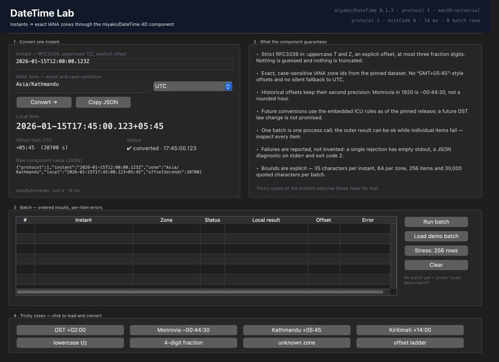
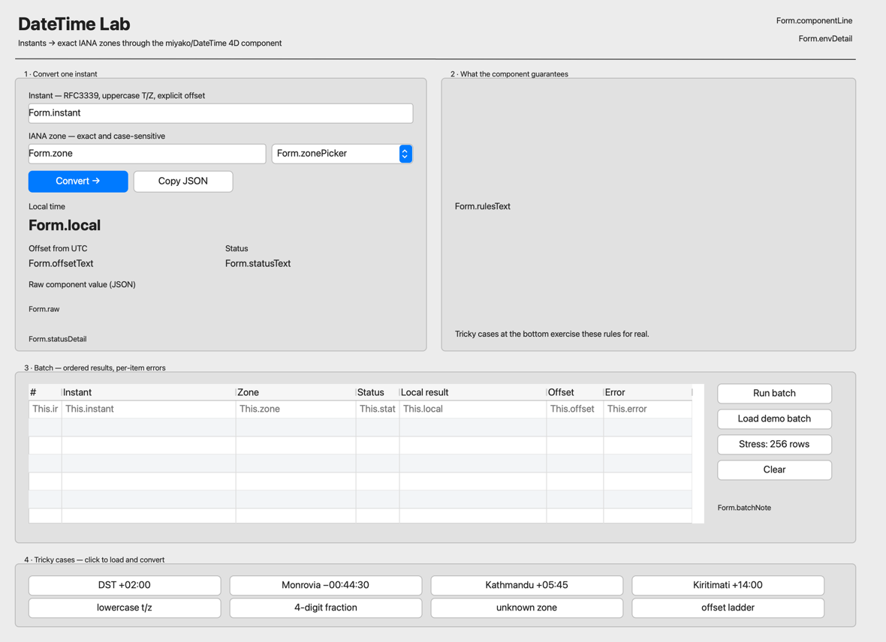

# DateTime-demo

An interactive 4D playground for [`miyako/DateTime`](https://github.com/miyako/DateTime): pick any
RFC3339 instant and any IANA zone, convert it with the component's real CLI, and see the local
time, the numeric offset and the raw protocol JSON side by side. A batch panel converts up to 256
pairs per call so you can watch partial failures stay attached to their input row.



The window above is a real capture of the running form (`FORM SCREENSHOT` on 21.2 LTS, dark
appearance) after `On Load` converted the default instant: Kathmandu `17:45`, `+05:45`. The static
render below comes straight from `Project/Sources/Forms/Lab/form.4DForm`, so its value fields are
empty:



## Run it

Requirements: **4D 21.2 LTS** (project `compatibilityVersion` `2102`) and the
**DateTime 0.1.3** component.

1. Clone the repository and open `Project/DateTime-demo.4DProject` in 4D.
2. The project declares its dependency in `Project/Sources/dependencies.json`. Accept the
   Dependencies panel prompt to install `miyako/DateTime` `0.1.3`; 4D's Dependency Manager downloads
   the GitHub release into the project.
3. Start the project. **Lab ▸ Open DateTime Lab** (or the startup method) opens the window.

Manual installation, if you prefer not to use the Dependency Manager: download `DateTime.zip` from
the [0.1.3 release](https://github.com/miyako/DateTime/releases/tag/0.1.3) and unpack it so that
`DateTime.4dbase` sits in `Components/` next to `Project/`.

## What the form does

| Area | Interaction |
| --- | --- |
| **Single conversion** | Edit the instant and pick one of 30 zones; *Convert* calls `convert`. The card shows the local time, the offset with its total seconds, a one-line status and the component's raw JSON reply. *Copy JSON* puts the raw reply on the clipboard. |
| **Guarantees card** | Eight rules the demo checks against the component: RFC3339 casing, offsets with seconds, next/previous day, half-hour and 45-minute zones, DST gaps, out-of-range instants and unknown zones. |
| **Batch grid** | *Run batch* sends the whole grid in one `convertBatch` call (1–256 items) and fills in per-row status, local time, offset or error. *Load demo* seeds eight rows (three deliberately invalid), *Stress 256* seeds 8 instants × 32 zones, *Clear* empties the grid. Selecting a row loads it back into the single-conversion card. |
| **Presets** | Eight buttons raise the tricky cases: Paris DST gap at 02:00, Monrovia's pre-1972 `-00:44:30` offset, Kathmandu `+05:45`, Kiritimati `+14:00` crossing the date line, lowercase `t`/`z`, four fractional digits, an unknown zone, and a 1970→2038 ladder. |

Everything the component rejects is shown the way the component rejects it: `ok:false`,
`error.code` and `error.message` are parsed out of the JSON that the CLI writes to stderr, and the
raw envelope remains visible in the *Raw JSON* panel.

## Verify headlessly

```sh
python3 scripts/fetch_dependency.py   # stages Components/DateTime.4dbase from the GitHub release
python3 scripts/verify.py             # runs Demo_SelfTest with tool4d, asserts the facts below
```

`verify.py` locates tool4d (`--tool4d`, `TOOL4D_PATH`, or `/Applications/4D 21.2 LTS*/…`), runs the
project's invisible `Demo_SelfTest` method, and asserts the report. Observed on 21.2 LTS build
21.100694:

```
PASS  report finished
PASS  component version line — miyako/DateTime 0.1.3 · protocol 1 · macOS-universal
PASS  Kathmandu conversion — 2026-01-15T17:45:00.123+05:45
PASS  DST offset before the gap — 2026-03-29T01:59:59.000+01:00
PASS  DST offset after the gap — 2026-03-29T03:00:00.000+02:00
PASS  invalid instant is rejected — ✖ invalid_instant
PASS  rejection carries JSON evidence — {"protocol":1,"error":{"code":"invalid_instant",…
PASS  demo batch has 5 ok / 3 failures — 8 rows · 5 ok · 3 item errors · exit 0 · 7 ms
PASS  stress batch keeps 256 rows — 256 rows · 200 ok · 56 item errors · exit 0 · 39 ms
PASS  stress batch reports 200 ok / 56 item errors
```

`scripts/verify.py` is interpreted-runtime evidence: it exercises the real component CLI on this
machine. It is not a compiled-mode check and not a Windows check.

## Findings and chokepoints

These are the things that cost time while building this, in order of how much they matter.

1. **tool4d has no Dependency Manager.** `dependencies.json` is inert there: the log says
   `PackageManager No component to fetch dependencies ()` and `Dependency 'DateTime' cannot be
   found ()`. Runtime still loads a component staged in `Components/`, so headless verification
   means staging the release first. That is exactly what `scripts/fetch_dependency.py` does.
2. **A compiled dependency's class store is not visible to `Compile project` under tool4d.**
   Interpreted code calls `cs.DateTime.DateTime.new()` fine, but compiling the same project reports
   `The class cs.DateTime is unknown.` (error) plus `convert` / `convertBatch` / `version` “does not
   exist on type `cs.DateTime.DateTime`” warnings — with 21.2 LTS *and* 21 R5, with the component in
   `Components/` or at the project root, and when compiling through a separate helper project as
   well. The release's generated `Resources/en.lproj/syntaxEN.json` lists only
   `new()` for the class, so the compiler never learns the method signatures. The demo therefore
   ships with interpreted-runtime acceptance; compiling it in the IDE with the dependency installed
   through the Dependencies panel is the supported developer path.
3. **Static text objects cannot bind `Form.x`.** A `text` object has no data source, so every value
   on this form is an `input` with `enterable:false`, `borderStyle:"none"`, transparent fill and no
   focus ring. That is what makes the card read as a dashboard while staying data-bound.
4. **Offsets are not always whole minutes.** Monrovia before 1972 answers
   `1920-05-31T23:15:30.000-00:44:30` (−2670 s). Formatting offsets as `HH:MM` silently truncates
   this; the demo renders `±HH:MM[:SS]` and shows the seconds separately.
5. **Errors arrive as JSON on stderr, wrapped in the generic envelope.** A rejection is
   `{ok:false, error:{code:"cli_error", message:"<the CLI's stderr JSON>"}}`. Printing `message`
   shows a wall of JSON; the demo parses it and keeps the raw text available.
6. **Batch failures are not batch failures.** `convertBatch` returns `ok:true` for the call with
   per-item `{ok:false, error}` results in input order. The grid colours rows individually and the
   header counts `5 ok · 3 item errors`; a demo that checks only the outer `ok` would call that run a
   success with three silent bad rows.
7. **4D collections are 0-based, and `For each` over `Form.rows` needs a hoisted declaration** —
   `For each (var $row : Object; Form.rows)` inside a button method is fine, but `var $rule : Text`
   inside a loop body is not. `Match regex`/`Position` with `*` is the case-sensitive form.
8. **Screenshots of a dialog need a second event cycle.** `FORM SCREENSHOT` right after
   `DIALOG` captures an empty window; the working recipe chains `CALL FORM` from the form method so
   the screenshot runs after the page is painted. The screenshot page parameter is **1-based**,
   while form page indices are 0-based, so the content page is requested as `2`.
9. **A form-data object replaces the form class instance.** The generic `dialog_screenshot` helper
   passes `{}` as the `DIALOG` form data. On a form that declares a `formClass`, that object *is*
   `Form`, so `On Load` dies with `A function was expected` (317) on `Form.convertCurrent()` and the
   capture shows the dimmed window behind the error dialog. Pass the class instance instead —
   `Project/Sources/Methods/lab_screenshot.4dm` builds `cs.TimeLab.new()`, sets `__page` /
   `__screenshotPath` on it, and reuses the same chained screenshot methods. The class must declare
   those two properties or the compiler (rightly) complains about undeclared `Form.*` writes.
10. **`FORM SCREENSHOT` in dark appearance is translucent.** The PNG has a real alpha channel: the
    window background is ~9 % opaque dark, so viewing the raw file over white looks washed out. The
    committed image is composited over `#1E1E1E`, which is what the form actually looks like.
    `FORM theme` is a getter — there is no per-form way to force light rendering for a capture.

## Layout

```
Project/DateTime-demo.4DProject        project anchor, compatibilityVersion 2102
Project/Sources/Classes/TimeLab.4dm    view model: state, presets, batch, self-test
Project/Sources/Forms/Lab/             the single-window form and its object methods
Project/Sources/Methods/Start.4dm      startup: reuse window, open "Lab"
Project/Sources/Methods/lab_screenshot CLI capture of the running form (class-aware DIALOG)
Project/Sources/Methods/Demo_SelfTest  invisible headless driver used by scripts/verify.py
Project/Sources/dependencies.json      GitHub dependency miyako/DateTime 0.1.3
scripts/fetch_dependency.py            headless stand-in for the Dependency Manager
scripts/verify.py                      acceptance run with tool4d
```

`docs/lab-runtime.png` is a live `FORM SCREENSHOT` of the running window, composited over the dark
window background. `docs/lab-static.png` is rendered directly from
`Project/Sources/Forms/Lab/form.4DForm`.

## Limitations

- Windows is untested. The component reports `Windows-x64` there; the demo itself is plain 4D code.
- The window is a fixed 1160 × 856 dialog, sized for a laptop screen; it does not reflow.
- The batch grid is capped at 256 rows by the component's documented limit.
- `Invisible` helper methods (`Demo_SelfTest`, `Demo_IgnoreError`, `Demo_LogError`, `lab_screenshot`,
  the screenshot chain) have no UI.
- The runtime screenshot was taken in dark appearance; the form is theme-neutral but its preview
  render is light.

## License

MIT — see [LICENSE](LICENSE).
